<a href="README.md">🇬🇧 English</a> | 🇩🇪 Deutsch

## Über mich

Ich studiere Elektro- und Elektronikingenieurwesen an der Universität Duisburg-Essen in Duisburg, Deutschland. Mich begeistern Projekte, in denen Hardware, Software und Forschung zusammenkommen. Die meisten meiner Repositories sind privat; auf Anfrage gebe ich gern Zugang.

## Was ich mache / Interessen

- **LLM-Entwicklung** — der KI-Assistent auf meiner persönlichen Website auf Basis der Claude API sowie ein Automatisierungspanel für soziale Medien mit FastAPI und KI-generierten Inhalten.
- **Webdesign & Deployment** — Websites und Web-Apps mit HTML/CSS/JavaScript, TypeScript, React und Next.js, bereitgestellt auf Vercel und Cloudflare.
- **Schaltungsentwurf** — Leistungselektronik und PCB-Design, zum Beispiel eine modulare 330-W-Powerstation mit Batteriemanagementsystem sowie Thermik- und Akkulaufzeit-Simulationen.
- **3D-Design** — interaktives 3D mit Three.js, etwa der gestengesteuerte [Gesture 3D Viewer](https://github.com/beyzakararti/gesture-3d-viewer) und ein 3D-Globus zur Routensimulation, außerdem CAD-Arbeiten mit SolidWorks, Catia und Siemens NX.
- **Forschung & Entwicklung** — Signalverarbeitung und maschinelles Lernen zur Fehlererkennung anhand von Motorgeräuschen, blockchainbasierter Energiehandel und weitere Arbeiten auf meiner [Forschungsseite](https://www.beyzakararti.com/research.html).

**Sprachen:** Englisch (C1), Deutsch (A2–B1), Türkisch

## Projekte

- **[Gesture 3D Viewer](https://github.com/beyzakararti/gesture-3d-viewer)** — 3D-Modelle und Folien per Handgesten vor der Webcam steuern.
- **[Pati-Nabız](https://app.vetaisoft.com)** — Plattform für Gesundheit und Pflege von Haustieren (live; privates Repository).
- **FRAGWATT** — eine tragbare, modulare 330-W-Powerstation für Gaming-Laptops (privat).
- **ATLAS** — ein 3D-Verkehrsobservatorium für die ganze Welt mit Routensimulation (privat).
- **MotorSense** — eine mobile App, die Motorgeräusche analysiert, um frühe Fehler zu erkennen (privat).
- **DablSync** — Website und Anwendungen für ein Granulat-Dosiersystem von Sabyeza Dynamics (privat).
- **Arkoveya Energy Forward** — eine Pilotplattform für Forward-PPAs mit erneuerbarer Energie für Unternehmen (privat).
- **Inkasa Foods Social-Media-Panel** — ein Dashboard zur Verwaltung der Social-Media-Konten einer Marke (privat).
- **[beyzakararti.com](https://www.beyzakararti.com)** — meine persönliche Website mit dem KI-Assistenten byeza.ai.

## Technologien

  

## GitHub-Statistiken

<table align="center">
  <tr>
    <td valign="top"></td>
    <td valign="top"></td>
  </tr>
</table>

Enthält Aktivität in privaten Repositories (nur Zahlen, keine Repository-Namen). Täglich aktualisiert.

  <picture>
    <source media="(prefers-color-scheme: dark)" srcset="https://raw.githubusercontent.com/beyzakararti/beyzakararti/output/github-snake-dark.svg" />
    <source media="(prefers-color-scheme: light)" srcset="https://raw.githubusercontent.com/beyzakararti/beyzakararti/output/github-snake.svg" />
    
  </picture>

## Kontakt

- Website: [beyzakararti.com](https://www.beyzakararti.com)
- Lebenslauf: [beyzakararti.com/cv](https://www.beyzakararti.com/cv.html)
- LinkedIn: [linkedin.com/in/beyza-kararti](https://www.linkedin.com/in/beyza-kararti)
- E-Mail: [beyza.kararti@outlook.com](mailto:beyza.kararti@outlook.com)
- ResearchGate: [Beyza Kararti](https://www.researchgate.net/profile/Beyza-Kararti)
- Standort: Duisburg, Deutschland
